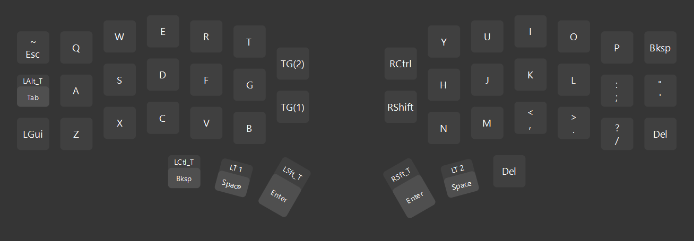
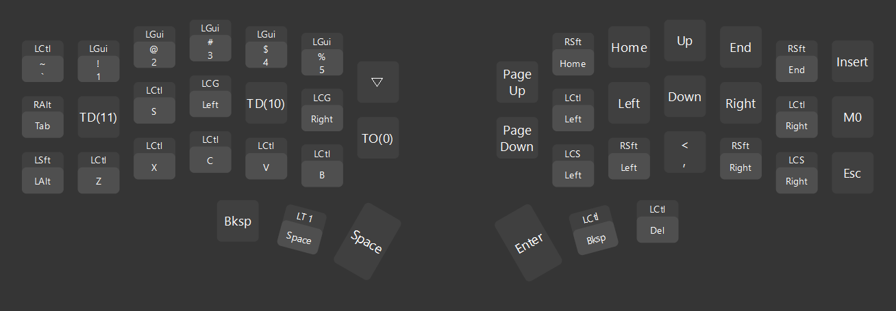
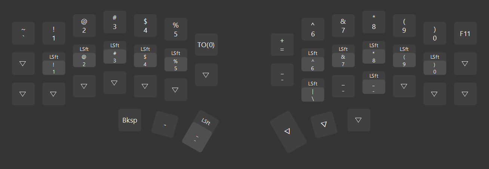

# Cornelius V1 Keyboard
My design of a very **efficient**, and **ergonomic** hand wired keyboard based on the Corne split keyboard.


---

# About the Project 
The modern keyboard is hardly an ergonomic/efficient solution for our modern times. 
The layout and structure is retained as an hommage for the old typewriter. While preserving historical artifacts and concepts is usually a good cultural idea. It is not smart for the sake of progress. 
Specifically in the case of the old typewrite:
</br>

</br>

1. The characters were staggered, so as to prevent hammer overlap. Today there is no need for that, because there are hammers. Its all digital. No reason to stagger and bend the fingers this way and that.
2. The layout intentially makes little sense, so as to prevent jamming by stratigically placing frequently used character combinations farther apart.
This is definitly not a requisite anymore, but a hinder of progress.

To that end, the keyboard community has decided on attacking this inefficiency in two main paths. Changing the physical keyboard configuration, and changing the layout itself.

## Changing the 'QWERTY' layout:
- On 1936, Dr August Dvorak submitted a pattent for a more efficient layout nowadays called the `DVORAK`. This layout places the most frequently used characters on the home row, reducing finger pain and enhancing typing capabilitied.
- In 2006, `COLEMAK` was created. This layout is a supposed to make the `DVORAK` layout more accessible and easier to trasition to for `QWERTY` users.
- Nowadays with the AI revolution, one deveoper had used genetics algorithms and ML models to analyze hand movement and optimised to reduced finger fatigue while increasing efficiency. This layout desinged as a solution by the AI research is called `HALMAK`

## Changing the keyboard configuration
First of all, people realize one does not need to stagger the characters anymore with digital keyboards, so they unstaggered them, giving us keyboards like the [planck by scotto](https://olkb.com/collections/planck) by olkb.
Then they realized we dont need to bend our rists together when typing, causing long term injury. So they split the keyboards, giving us keyboards like the [ForScience keyboard](https://github.com/diimdeep/awesome-split-keyboards/blob/master/img/ForScience.jpg)
Then they realized that maybe the want to keep the stagger, but int the more natural **vertical** axis. Giving us the [Corne by Foostan](https://github.com/foostan/crkbd).

Looking at these keybaords one might notice that some keys are missing. This is due to the ability to layer keyboards on top of each other (digitally), utilizing keys to transfer between layouts, just as the SHIFT key changes the entire character layout to be capitalized. For me the ability to layer layouts was the huge selling point to build one of those. So I did. 
I have to admit I have not used tried a new layout, but am leaning towards DVORAK or HALMAK. 

For now, I will showcase my work and recent journey into building my own best producive and ergonomic keyboard - 

---

# THE CORNELIUS V1
### Features
1. 42 programmable keys
2. 10 degree tilt between keyboard sides
3. Utelizes the RP2040 MCU
4. Has a screen to indicate the corrent layer
5. Also has a mouse configuration
6. Runs [Vial](https://get.vial.today/)-QMK: remap it live in the Vial app, with the same layout as my Pilot W-Corne
7. RP2040-zero is swappable quickly if burned. No soldering required.

### Versions I built before the Cornelius V1
After building my first macropad, [posted on my website](https://www.asafslaboratory.com/?p=416) I started building full keyboards.

#### 1. REDOX 2
Back in 2022 I found [this youtube video](https://www.youtube.com/watch?v=Cwkf7HFcUkY&list=LL&index=162&t=321s&ab_channel=Shiftux) by Shiftux which ignited my passion for split keyboards. Here was the initial result:


I took apart an old keybaord birthday present for the switches and put it together. After seeing it worked I have decided to pivot to a smaller form factor keybaord, which led me to the my next try

#### 2. REDOX 2.2
I wanted to make the keeb smaller and encorporate a big scroller wheel next to the thumb so I designed and built this:


#### 3. Choco REDOX
Next I wanted a lower profile using Gateron low profile switches, so I designed and built this:


I had used this keyboard for a long time, until I decided to go smaller, towards the Corne, and leave the split keyboard world. 
The split keyboards are a delight, but aren't easy to carry around without a proper case. 

That brings me to the CORNELIUS V1. Which is really useful and fun.

### Current layout of the Cornelius 1
I keep changing the layout from time to time, trying to find the best one for me. It now lives in
[Vial](https://get.vial.today/) and is shared with my other Corne (a Pilot W-Corne), so both keyboards type
exactly the same. These pictures are drawn from [`layout/cornelious.vil`](layout/cornelious.vil) with Vial's own
renderer (`scripts/render_layers.py`).

The W-Corne has two extra keys in the inner column of each half (the `TG`/`TO` and Right Ctrl/Shift keys in the
middle). The Cornelius has 42 keys, so it doesn't have those four.

#### BASE LAYER


#### NAVIGATION LAYER (hold left middle thumb)


#### SYMBOL LAYER (hold right middle thumb)


The RP2040-Zero's onboard LED shows which layer is active: **green-teal** for base,
**orange** for navigation, **yellow** for symbols. Its brightness can be changed in Vial's Lighting tab.

Layers 3-7 are empty (all transparent). Until November 2026 the Cornelius ran KMK, configured with
JanLunge's [POG](https://github.com/JanLunge/pog). That firmware and its layout are kept on the
[`kmk` branch](../../tree/kmk) (tag `kmk-final`).

---

# Build it yourself

## Components
1. RP2040-Zero
2. 0.96" OLED I2C Display
3. Gateron Low Profile 2.0 Mechanical Switch
4. Low porfile PBT Cherry MX keycaps
5. 3d printed case
6. m2.5 Screws
7. m2.5 Spacers
8. 1N4148 Diods
9. Rubber Feet

TODO - Rest of guide

---

# Firmware (Vial-QMK)

One Vial layout for every Corne I own. This repo is the single source of truth for
the layout and for the Vial-QMK firmware of each board, so every Corne types the
same and one `.vil` file loads on all of them.

### What's here

| Path | What it is |
| --- | --- |
| `layout/cornelious.vil` | **The layout.** Vial export of the Pilot W-Corne. Everything else follows from it. |
| `layout/w-corne-vial.json` | The W-Corne's own Vial definition, read from its firmware (reference). |
| `qmk/keyboards/cornelious/` | The QMK keyboard. Copied into vial-qmk at build time. |
| `qmk/keyboards/cornelious/<board>/` | One folder per physical board: controller and wiring. |
| `qmk/keyboards/cornelious/keymaps/vial/` | Shared Vial keymap. `keymap.c` and `layout_settings.h` are generated from the `.vil`. |
| `scripts/build.sh`, `scripts/build.ps1` | Build firmware (Linux or WSL / Windows through WSL). |
| `scripts/vil2keymap.py` | Turns the `.vil` into `keymap.c` (run by the build). |
| `scripts/vial_tool.py` | Save or load a `.vil` over USB without the Vial app (optional). |
| `scripts/render_layers.py` | Draws the layer pictures in `docs/layers/` the way Vial shows them. |
| `docs/boards.md` | Hardware notes for every board. |

### Boards

| Board | Hardware | Firmware |
| --- | --- | --- |
| **B**: Pilot W-Corne | 46 keys (3x6+3, plus 2 extra inner keys per half) | Vendor Vial-QMK build, not built here. Its layout is the source of truth. |
| **A**: Cornelius V1 (`rp2040zero`) | 42 keys, handwired, one Waveshare RP2040-Zero drives both halves | Built from this repo |

See [docs/boards.md](docs/boards.md) for pins and wiring.

### How the layout stays the same everywhere

- Every board shows Vial the **same logical matrix** (4 rows x 12 columns, the
  W-Corne's) and the **same Vial UID**. A `.vil` saved from any board therefore
  loads on any other board, key for key.
- Each board's own wiring is translated to that matrix in its `config.h`
  (`CORNELIOUS_PHYS_TO_LOGICAL`), handled by the shared `matrix.c`.
- The firmware has the whole `.vil` baked in: all layers, tap dances, combos, key
  overrides, macros and QMK Settings. Vial-QMK wipes the board's saved layout the
  first time each new build boots, and the baked-in copy is what it falls back to.
  So a freshly flashed board is ready to use without loading anything.
- 42-key boards simply don't have the W-Corne's 4 extra inner keys. Whatever is on
  those keys is not reachable there (see "Layout notes" below).

### Changing the layout

1. Change it in Vial on any board.
2. Vial: **File > Save current layout**, save over `layout/cornelious.vil`.
3. Load that file on your other boards (**File > Load saved layout**).
4. Rebuild (`scripts\build.ps1`) and commit, so future flashes get it too.
   The build regenerates `keymap.c` from the `.vil`; CI fails if they drift apart.
5. Redraw the layer pictures above: `python scripts/render_layers.py`
   (needs `pip install PyQt5 simpleeval`).

### Building

**Windows** (uses WSL Ubuntu, no admin rights needed):

```powershell
.\scripts\build.ps1              # every board
.\scripts\build.ps1 rp2040zero   # one board
```

**Linux / WSL:** `scripts/build.sh [board]`

The first run downloads the QMK toolchain, a Python venv with the QMK CLI,
vial-qmk (pinned commit) and vial-gui into `~/.cache/cornelious`. That takes a few
minutes. Later builds take about a minute. Firmware lands in `firmware/`.

**GitHub Actions** builds every board on each push and uploads the `.uf2` files as
an artifact. Pushing a tag (`git tag v1 && git push --tags`) also creates a release
with the firmware and the `.vil`.

### Flashing an RP2040 board

1. Put it in bootloader mode:
   - QMK already on it: double-tap the reset button, or hold the top-left key while
     plugging in (this also clears the board's saved Vial changes).
   - Waveshare RP2040-Zero: hold **BOOT**, tap **RESET**.
   - CircuitPython/KMK on it: in its REPL run
     `import microcontroller; microcontroller.on_next_reset(microcontroller.RunMode.UF2); microcontroller.reset()`
2. A drive called `RPI-RP2` appears. Copy `firmware/cornelious_<board>_vial.uf2` onto it.
3. The board reboots as a Vial keyboard, already holding the layout.
4. Check it in Vial: the **Matrix tester** tab (unlock: hold the top-left and
   top-right corner keys) should light the right key for every key you press.

### Adding a new Corne

The shared matrix works for any board where **one controller scans all keys**,
like board A.

1. Make a folder `qmk/keyboards/cornelious/<name>/` (copy `rp2040zero/`).
2. `keyboard.json`: set `keyboard_name`, a new `usb.pid`, `processor`, `bootloader`
   and `board` for the controller.
3. `config.h`: list the row pins (driven low, diode cathode side) and column pins
   (read with pull-ups), then fill `CORNELIOUS_PHYS_TO_LOGICAL`. For every
   row/column crossing that has a switch, write which W-Corne key it is,
   `LK(row, col)`. Use `XX` for crossings with no switch. Logical positions:

   ```
   left half                                  right half
   (0,0) (0,1) (0,2) (0,3) (0,4) (0,5) [3,0]  [0,6] (0,7) (0,8) (0,9) (0,10) (0,11) (3,9)
   (1,0) (1,1) (1,2) (1,3) (1,4) (1,5) [3,1]  [1,6] (1,7) (1,8) (1,9) (1,10) (1,11) (3,10)
   (2,0) (2,1) (2,2) (2,3) (2,4) (2,5)              (2,7) (2,8) (2,9) (2,10) (2,11) (3,11)
                     (3,3) (3,4) (3,5)              (3,6) (3,7) (3,8)
   [ ] = the 4 extra inner keys, only on 46-key boards
   ```
4. Build it, flash it, check every key in the Vial matrix tester. If a key lights up
   in the wrong spot, fix that cell of the table.
5. Add the board to `docs/boards.md`.

**Split Cornes with a controller in each half** (a normal crkbd PCB with two Pro
Micro-style controllers) don't fit this scheme yet. QMK's split code needs each
half to own whole matrix rows, but the W-Corne's rows span both halves. Supporting
them needs a different approach, so it's left for when such a board comes along.

### Layout notes

The W-Corne's 4 extra inner keys hold things that 42-key boards can't reach:

| Layer | Left extra (upper / lower) | Right extra (upper / lower) |
| --- | --- | --- |
| 0 | `TG(2)` / `TG(1)` (layer locks) | Right Ctrl / Right Shift |
| 1 | (transparent) / `TO(0)` | Page Up / Page Down |
| 2 | `TO(0)` / (transparent) | `=` / `-` |

Of those, `=` (and with it `+`), Page Up/Down and the layer locks are on no other
key, so they're missing on board A. Moving them onto shared keys is a layout change:
make it in Vial and save it back to `cornelious.vil` as above.

### Going back to KMK

The [`kmk` branch](../../tree/kmk) (tag `kmk-final`) holds the KMK + POG firmware
exactly as it was on the board before the switch. To go back: flash CircuitPython
9.2.0 for the Waveshare RP2040-Zero, then copy that branch's files onto the
CIRCUITPY drive.
